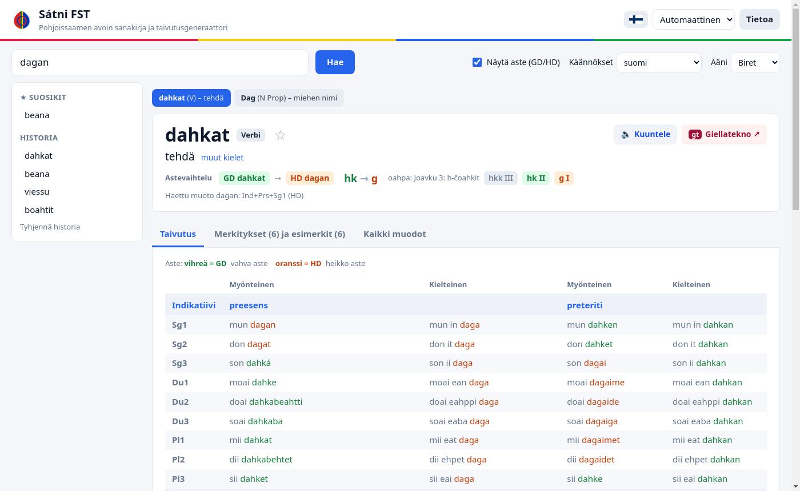
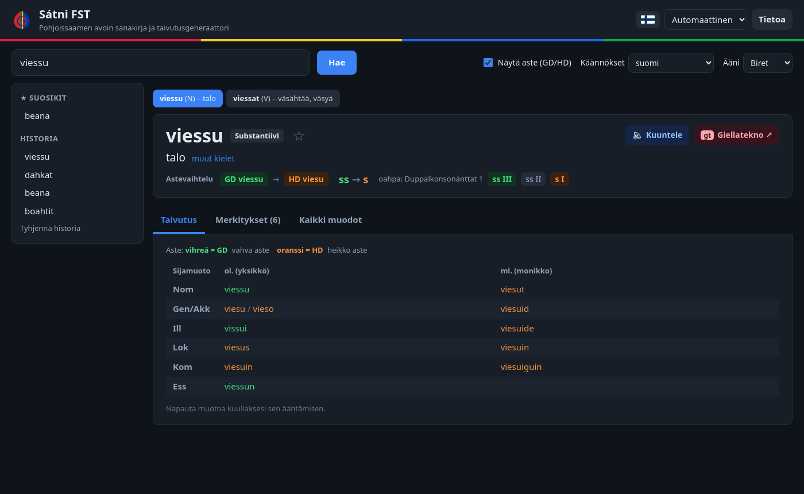
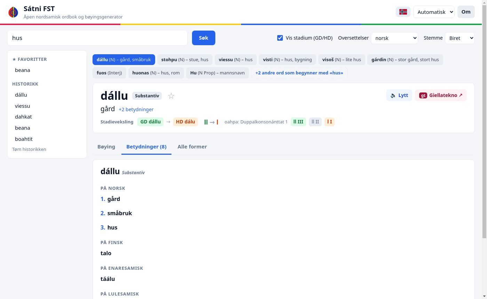
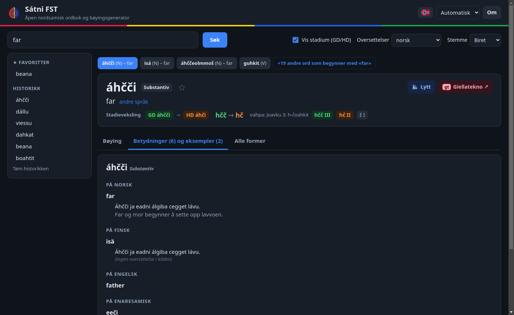
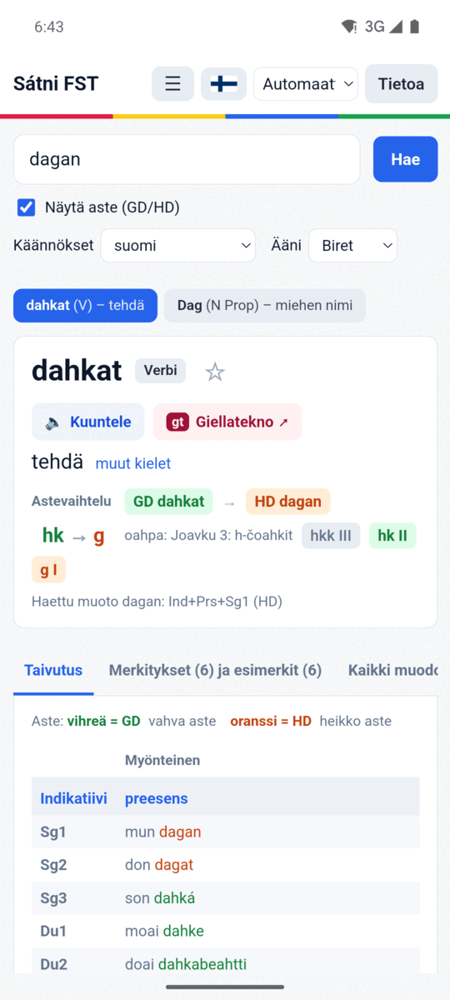
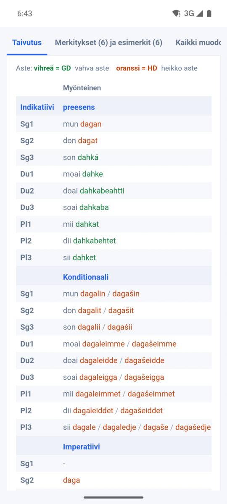
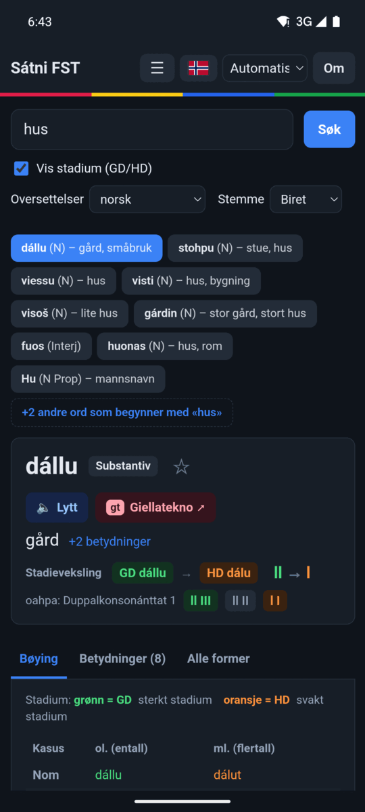
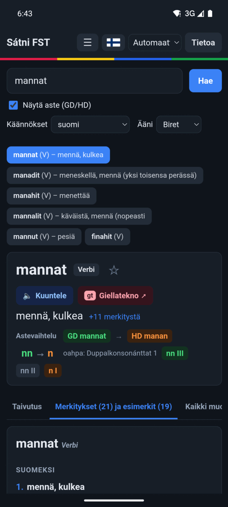

# Sátni FST

**An offline North Sámi dictionary with full inflection** — for Linux, Windows, Android and the web.

> **Suomeksi:** Pohjoissaamen sanakirja ja taivutin, joka toimii ilman verkkoyhteyttä. Käännökset suomeksi
> ja norjaksi, käyttöliittymä suomeksi tai norjaksi.
>
> **På norsk:** Nordsamisk ordbok og bøyingsverktøy som virker uten nett. Oversettelser til norsk og finsk,
> brukergrensesnitt på norsk eller finsk.

Sátni FST combines the open dictionaries and morphology of [GiellaLT](https://giellalt.github.io/),
[Divvun](https://divvun.no/) and [Giellatekno](https://giellatekno.uit.no/) into one app.
**All language data comes from them — see [CREDITS.md](CREDITS.md).**

## Features

- About 80 000 North Sámi words, about 74 000 of them with full inflection tables
  (all moods for verbs, cases in singular and plural for nominals)
- Consonant gradation shown in colour (strong grade GD / weak grade HD)
- Translations in Finnish and Norwegian, and for some words English, Inari, Lule and Southern Sámi
- Search with a North Sámi word, an inflected form (*dagan* → *dahkat*) or a Finnish/Norwegian word
- Pronunciation with Divvun's speech synthesis (voices Biret, Máhtte, Sunná; needs a network connection)
- User interface in Finnish or Norwegian, light and dark theme, history and favourites

## Screenshots

**Desktop** (Linux and Windows) — light and dark theme, Finnish and Norwegian user interface:

| | |
|---|---|
|  |  |
| *Search with an inflected form: **dagan** finds **dahkat** (to do)* | *Dark theme: nouns in all cases, singular and plural* |
|  |  |
| *Search with a Norwegian word: **hus** → *dállu*, *viessu* …* | *Meanings and example sentences in several languages* |

**Android:**

<table>
  <tr>
    <td align="center" width="25%"> <em>Word card</em></td>
    <td align="center" width="25%"> <em>Inflection table</em></td>
    <td align="center" width="25%"> <em>Norwegian, dark mode</em></td>
    <td align="center" width="25%"> <em>Meanings</em></td>
  </tr>
</table>

## How to use

1. **Search** with a North Sámi word in any form (*dagan*, *viesus*), or with a Finnish or Norwegian word (*talo*, *hus*).
2. **Pick a result** from the row of buttons. Words that only begin with your search are behind the "+N other words" button.
3. **The word card** shows the translation, the word class and the consonant gradation:
   green **GD** = strong grade, orange **HD** = weak grade.
4. **Tabs:** *Inflection* (the full table), *Meanings and examples*, and *All forms* (every form the morphology generates).
5. **Listen** (🔈) plays the word with speech synthesis; tapping a form in the inflection table plays that form.
6. **Settings:** the flag button changes the user interface language (Finnish/Norwegian), *Translations* the translation language,
   and the theme menu switches between light, dark and automatic. The ☆ star saves a word to your favourites.

## Building

The finished apps are built from these steps. Most build steps run in Docker, so little needs to be installed.

| Step | Command | Needs |
|---|---|---|
| 1. Download the GiellaLT dictionaries | `./hae_sanakirjat.sh` | git |
| 2. Build the database (`satni.db`, ~10 min) | `python3 import_full_dict.py` | Python 3, [HFST](https://hfst.github.io/) (`hfst-lookup`) |
| 3. Desktop apps (AppImage + Windows) | `./build.sh` | Docker; a Windows VM for the Windows build (see `build_qt_exe.sh`) |
| 4. Android app (APK) | `./build_apk.sh` | Docker |
| 5. Release | attach `dist/Satni_FST-x86_64.AppImage`, `dist/satni-fst-windows.zip` and `dist/satni-fst.apk` to a GitHub release | — |

The web version (`web/`) needs only `python3 export_web_data.py` and any static web server.

The compiled FST models are included in [`src/fst/`](src/fst/SOURCE.md), so building
[lang-sme](https://github.com/giellalt/lang-sme) yourself is not necessary.

Comments in the source code are in Finnish; the release notes and commit messages are in English.

## Licence

Sátni FST is free software under the [GNU General Public License v3.0](LICENSE).
The dictionaries are © GiellaLT and licensed under CC BY 4.0, the morphology (lang-sme) under GPL-3.0 —
see [CREDITS.md](CREDITS.md) for all sources, licences and the changes made to the data.

Feedback: Juha Somby, <satni@somby.fi>
